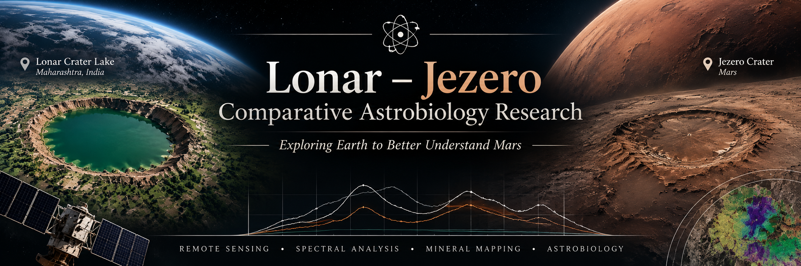
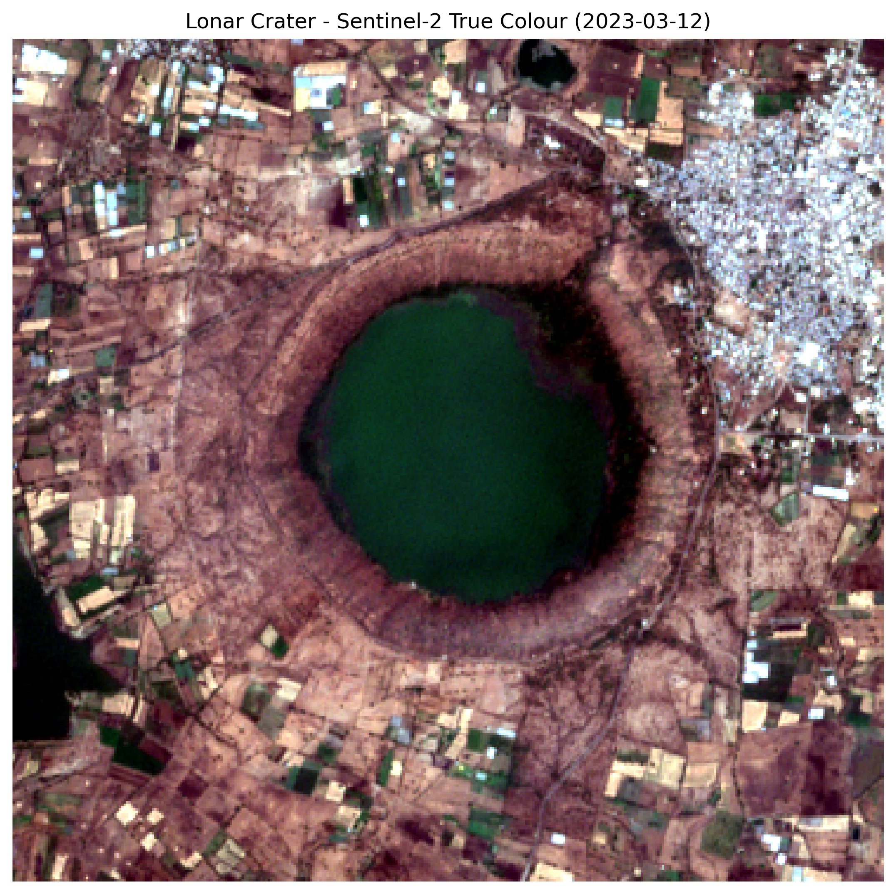
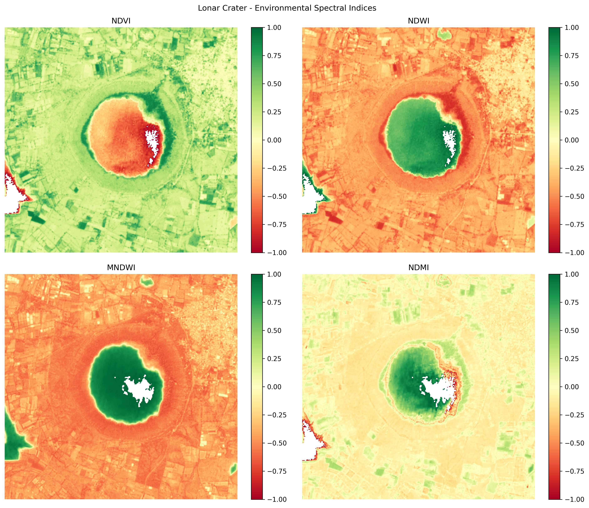
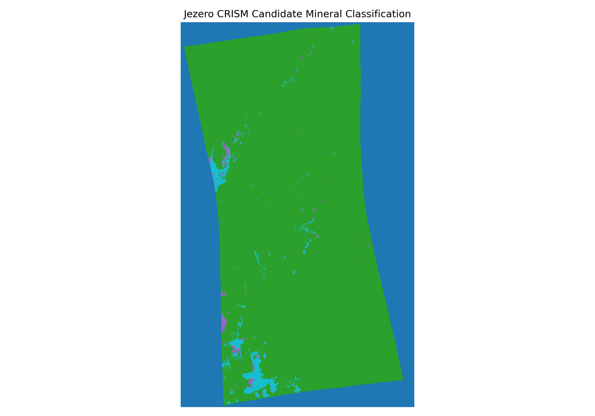

# Lonar Lake–Jezero Comparative Astrobiology Research

  

<h3 align="center">
  A Computational Study of Terrestrial and Martian
  Spectral Signatures
</h3>

  
  
  
  

---

## 1. Research Overview

This research investigates the use of Lonar Crater Lake,
Maharashtra, India, as a terrestrial planetary analogue
for comparative analysis with Jezero Crater on Mars.

The study uses satellite remote sensing, hyperspectral
data processing and computational spectral analysis
to investigate environmental and mineral-associated
spectral patterns.

The primary objective is to explore how biological-associated
and abiotic spectral patterns can be distinguished in a
terrestrial analogue and their implications for interpreting
ancient Martian lake environments.

## 2. Study Areas

### Earth Analogue – Lonar Crater Lake
- Location: Maharashtra, India
- Dataset: ESA Sentinel-2 Level-2A
- Data catalogue: Microsoft Planetary Computer

### Mars – Jezero Crater
- Planetary mission: Mars Reconnaissance Orbiter
- Instrument: CRISM
- Dataset: Hyperspectral imaging data

## 3. Research Objectives

1. Process satellite imagery of Lonar Crater.
2. Perform geospatial preprocessing and cloud masking.
3. Extract environmental and spectral information.
4. Analyse CRISM hyperspectral data from Jezero Crater.
5. Extract spectral signatures from different regions.
6. Compare spectra with USGS reference mineral spectra.
7. Apply Spectral Angle Mapper (SAM).
8. Investigate similarities and differences between
   terrestrial and Martian spectral patterns.

## 4. Technologies and Libraries

- Python
- Google Colab
- NumPy
- Pandas
- Matplotlib
- Rasterio
- GeoPandas
- SciPy
- PySTAC Client
- Planetary Computer
- Spectral Python
- PDS4 Tools

## 5. Methodology

### Phase 1 – Satellite Data Acquisition

Retrieval of Sentinel-2 Level-2A imagery through
Microsoft Planetary Computer STAC API.

CRISM hyperspectral data used for Jezero analysis.

### Phase 2 – Geospatial Preprocessing

- Coordinate transformation
- Raster alignment
- Spectral band extraction
- Reflectance conversion
- Cloud and invalid-pixel masking

### Phase 3 – Environmental Mapping

- RGB image composition
- NDVI analysis
- NDWI analysis
- Environmental pixel classification

### Phase 4 – Spectral Signature Extraction

Extraction and comparison of spectral signatures
from selected regions of interest.

### Phase 5 – CRISM Hyperspectral Analysis

Processing of Jezero CRISM data and extraction of
regional spectral profiles.

### Phase 6 – Mineralogical Characterization

Comparison with USGS reference spectral libraries.

### Phase 7 – Spectral Angle Mapper Analysis

SAM-based spectral similarity assessment and
mineral reference comparison.

### Phase 8 – Validation and Results

- Spectral quality assessment
- Invalid-band identification
- Equal-band comparison
- SAM similarity matrices
- Mineral classification visualisation

## 6. Research Visualisations

### Lonar Crater — True Colour Image

### Lonar — Environmental Indices

### Jezero — CRISM False-Colour Composite

.png)

### Jezero — ROI Spectral Profiles

.png)

### Jezero — Final Mineral Map

## 7. Research Outputs

The computational workflow generates:

- Satellite image composites
- Environmental index maps
- Spectral profiles
- ROI comparison results
- SAM similarity matrices
- Mineral classification maps
- CSV validation datasets

## 8. Research Significance

This study provides a computational framework for
investigating terrestrial planetary analogues and
interpreting remotely sensed spectral information
from ancient Martian environments.

Spectral similarity is treated as a mineralogical
comparison tool, not as direct evidence of past life.

## 9. Researcher

**Amartyesh (Ash)**

Computational Astrobiology Research

## 10. Licence 

---

  <b>Exploration beyond Expectation.</b>

